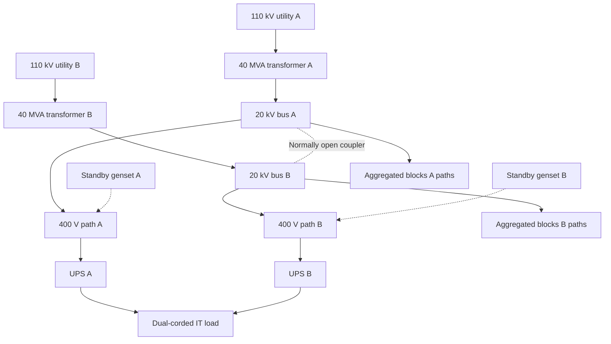

# MissionCriticalGrid — electrical infrastructure engineering work sample

**Status: preliminary analytical screening. Not application-ready as a completed engineering study.**

Independent educational case study of a synthetic 110/20/0.4 kV data-centre campus. No affiliation with a consultancy, operator or client. The design is not approved, certified or suitable for construction. The long-term PowerSystemsLab curriculum is independent of this work sample.

Start with [design basis](../../applications/mission-critical-grid/DESIGN_BASIS.md), [preliminary results](PRELIMINARY_SCREEN.md), [study plan](STUDY_PLAN.md) and [evidence register](EVIDENCE.md). The public work sample will link to qualified shared methods instead of duplicating code.

## Reference topology (conceptual; not an engineering SLD)



Switches, breakers, cooling feeders, earthing and protection are omitted in this conceptual diagram; these must be specified in the full SLD. Utility independence is not established.

## Reproduce
```sh
python work-samples/mission-critical-grid/screening.py
python -m unittest discover -s work-samples/mission-critical-grid -v
```
The reference calculation was AI-assisted and locally tested. Results below are not a pandapower, PowerFactory or PSCAD simulation.
